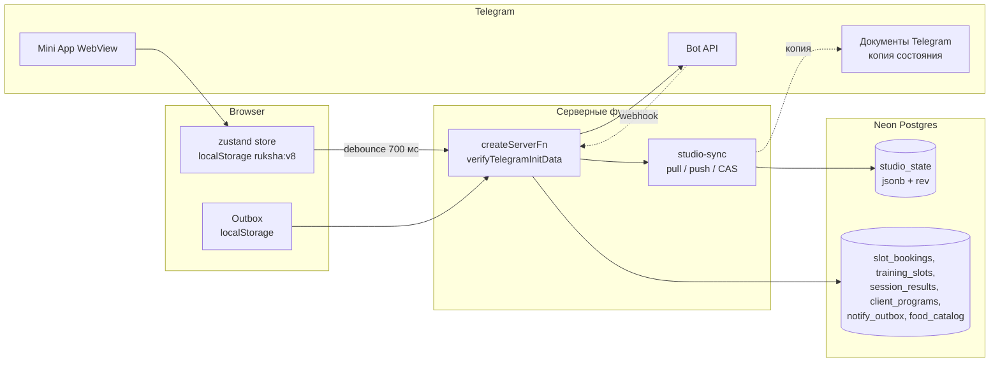

# Текущая архитектура (фактическая)

База: `origin/main` = `db1bf81`. Статусы: см. легенду в `EXECUTIVE_SUMMARY.md`.

## 1. Стек (К — из `package.json`, `vite.config.ts`, `Dockerfile`, `vercel.json`)

- Фронтенд: React 19, TanStack Start/Router/Query, zustand (`src/lib/studio-store.ts`), Tailwind 4, Radix (часть не используется).
- Сервер: серверные функции `createServerFn` (TanStack Start), маршруты `src/routes/api/*`, Nitro.
- Данные: Neon Postgres через `pg.Pool` (`src/lib/db.ts`); PGLite (`idb://ruksha-discipline`) как локальный фоллбэк без `DATABASE_URL`.
- Telegram: Mini App (initData), Bot API через `fetch` (`src/lib/telegram-bot.server.ts`), вебхук `/api/telegram`, Telegram-документы как резервная копия состояния (`src/lib/studio-remote.ts`).
- Хостинг: Vercel (основной, `vercel.json`, `README`), Railway (Dockerfile + `railway.toml`, описан как запасной).
- Тесты: `node:test` + `tsx`, список файлов задан явно в скрипте `test`.

## 2. Схема (К — по коду; Ч — по чтению)

Ключевое: **два источника истины** для одних и тех же данных. Состояние студии — один jsonb-документ `studio_state` (строка `'ruksha'`, `src/lib/studio-sync.ts:86`). Бронирования, результаты и outbox — отдельные реляционные таблицы. Часть бронирований пишется в обе стороны (dual-write), часть — только в одну (К, `src/lib/booking/server.ts`).

## 3. Серверные функции и маршруты (К/Ч)

Полная таблица с проверками — `SECURITY_AUDIT.md`, раздел 2. Кратко:

- Все функции, принимающие `initData`, проверяют HMAC (`src/lib/telegram-auth.server.ts`). Без `BOT_TOKEN` функция отказывает (К, `:24-26`).
- Без аутентификации: `GET /api/telegram` (вызывает `setWebhook`), `GET /api/db-status` (отдаёт только `ok`, К), `GET`/`POST /api/health` (bearer `healthToken`, К).
- Клиентские id в запросах: `bookSlotFn` (слот целиком от клиента, F-02), `suggestProgressionFn` (`clientId`, `programId`), `flushOutboxServerFn` (`telegramId`), `importClientsFn` (`c.id`).

## 4. Модель данных (К — `migrations/*.sql`)

| Таблица | Назначение | Замечания |
|---|---|---|
| `studio_state` | весь blob студии, `payload.rev` | одна строка; ревизия внутри jsonb, не колонка |
| `studio_state_backup` | резервные копии | нет PK, нет очистки |
| `app_users` | роли (CSV-импорт) | `telegram_id` unique, `role` check |
| `training_slots` | слоты | `owner_coach_id` без FK; capacity ≤100 |
| `slot_bookings` | записи | unique(slot_id, client_id); `client_id` без FK; статус `cancelled` никто не пишет (F-07) |
| `session_attendance`, `session_results` | явка и результат | unique(booking_id) — повтор возвращает `created:false` без обновления |
| `client_programs` | версии программ | unique(coach_id, client_id, version); без FK |
| `progression_rules`, `progression_suggestions`, `trainer_decisions` | прогрессия | каскадные FK |
| `notify_outbox` | очередь уведомлений | миграция 0005 с пометкой «не применять без approval» (F-05) |
| `food_catalog` | общий каталог продуктов | глобальный, первая запись побеждает (К, `src/lib/food-catalog.ts:55-63`) |

RLS, политик и шифрования на уровне приложения нет (К). Вся авторизация — в серверном коде.

## 5. Клиентская часть (Ч)

- Все экраны читают zustand-стор. Исключения — статические каталоги: `MEALS`, `MACHINES`, `DEMO_BARCODES`, `OFFERS` (`src/components/app/guest-preview.tsx:14-18`).
- Синхронизация: `refreshCloud` каждые 12 с и при `visibilitychange` / `online` (`mini-app.tsx:119-132`).
- Два каталога штрихкодов: `src/data/studio.ts` (живой) и `src/data/scan.ts` (дубль, частично импортируется).

## 6. Сборка и деплой (К)

- `npm run build` = `node scripts/migrate.mjs && vite build` (`package.json:12`). Миграции запускаются при каждой сборке, если в env есть `DATABASE_URL` (F-05).
- CI (`.github/workflows/ci.yml`): typecheck, test, build; без `npm audit`, lint, `check:auth`.
- Два целевых деплоя с разными флагами: `VITE_AUTH_ENABLED=false` в `Dockerfile:11,29` и `railway.toml:14`. Значение на Vercel неизвестно (Н).
- `startup.sh` ссылается на `/workspace`, `scripts/preview.mjs` (отсутствует) и не участвует в деплое (К). Его стоит удалить.

## 7. Что сейчас не работает или не подтверждено

- Атомарность бронирования на Neon (F-01) — не работает по коду.
- Отмена записи в Neon — не работает (F-07).
- Outbox: повторной отправки и учёта ошибок нет (F-10).
- Выполнение тестов в CI не гарантировано (F-14).
- Состояние продакшн-БД (какие миграции применены) — не проверено (Н).
